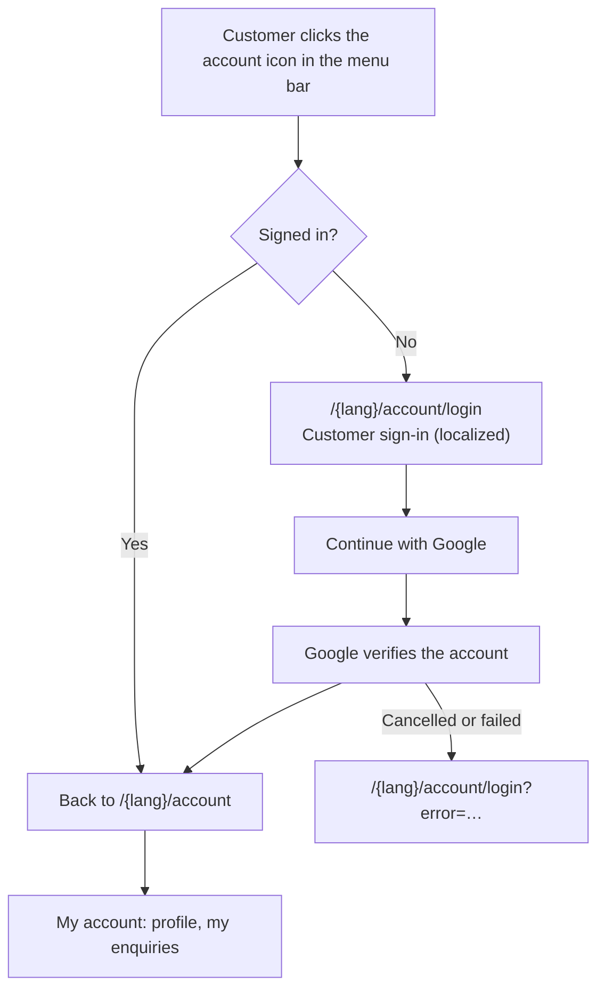
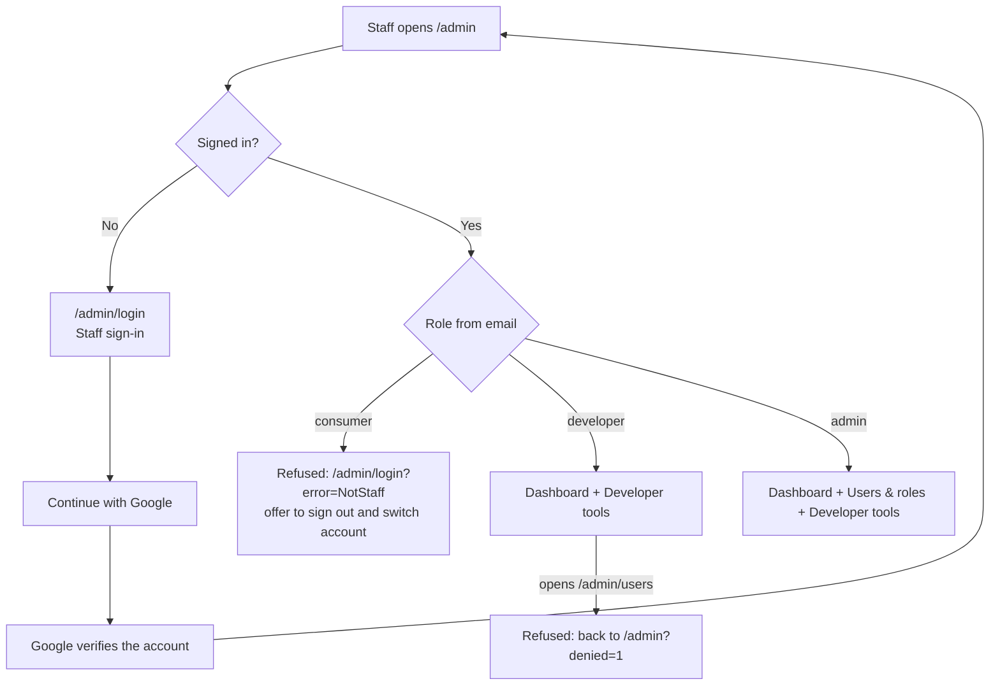

# Sign-in Flows: Admin, Developer and Consumer

This site has three kinds of users. They sign in the same way (Google), but they use
**separate entry points, separate areas, and separate permissions**.

| | Admin | Developer | Consumer |
| --- | --- | --- | --- |
| Who | Business owners and managers | Technical staff and contractors | Website customers |
| How the role is given | Email listed in `ADMIN_EMAILS` | Email listed in `DEVELOPER_EMAILS` | Any other verified Google account |
| Login page | `/admin/login` (English, "Staff sign-in") | `/admin/login` | `/en/account/login` or `/ar/account/login` |
| After login goes to | `/admin` | `/admin` | `/en/account` or `/ar/account` |
| Area | Staff area (`/admin/*`) | Staff area, limited | Customer area (`/{lang}/account`) inside the public site |
| Can open | Dashboard, Users & roles, Developer tools, own account | Dashboard, Developer tools, own account | Own account only |
| Cannot open | — | Users & roles | Anything under `/admin` |

## The core idea: identity vs access

1. **Identity (who are you?)** is handled once, by Google through NextAuth (`src/lib/auth.ts`).
   Any verified Google account can prove who it is.
2. **Access (what may you open?)** is decided by the server on **every request** from the email address
   (`src/lib/roles.ts`). The role is never trusted from the browser cookie, so changing an allowlist
   takes effect immediately, without asking anyone to sign out.
3. **Each area has a guard** (`src/lib/guards.ts`) that runs before any page in that area renders:
   - `requireStaff(permission)` protects `/admin/*`
   - `requireAccount(locale)` protects `/{lang}/account`

Because the guards run on the server, hiding a menu link is only for convenience. Even someone who types
the URL directly is still stopped.

## Flow diagrams

### Consumer

### Staff (admin and developer)

## Permission matrix

Defined once in `src/lib/roles.ts`; the "Users & roles" admin page displays the same table.

| Permission | Admin | Developer | Consumer |
| --- | :-: | :-: | :-: |
| `dashboard:view` | ✓ | ✓ | — |
| `content:view` | ✓ | ✓ | — |
| `users:view` | ✓ | — | — |
| `devtools:view` | ✓ | ✓ | — |
| `enquiries:view` | ✓ | — | — |
| `enquiries:manage` | ✓ | — | — |
| `account:view` | ✓ | ✓ | ✓ |

To add a permission: add a line to `permissions` in `roles.ts`, then call `requireStaff("your:permission")`
at the top of the page that needs it.

## Why the areas are kept apart

- **Different doors.** Customers never see a link to `/admin`. Staff use a separate, unbranded-for-customers login page.
- **Different look and language.** The customer area is part of the bilingual public site. The staff area is a separate
  English-only shell with its own layout, marked `noindex`.
- **Safe defaults.** A new Google account is always a consumer. Staff access exists only if someone adds the email
  to an allowlist on the server.
- **Least privilege.** Developers can see technical status (which settings exist, runtime, endpoints) but not user
  management, and secret **values** are never displayed.
- **Short sessions.** Sessions expire after 8 hours.

## Production recommendations

| Topic | POC today | Recommended for production |
| --- | --- | --- |
| Where roles are stored | Email allowlists in host settings | A `users` table with a `role` column, managed from the Users & roles page |
| Staff vs customer cookies | One session cookie for the whole site | Serve the staff area from its own subdomain (e.g. `admin.sajakw.com`) so the sessions are fully separate |
| Customer sign-in options | Google only | Add email magic link or email + password (needs a database) |
| Staff sign-in hardening | Google account | Require Google Workspace accounts on the company domain with 2-step verification enforced |
| Audit | None | Log staff sign-ins and changes |
| Google consent screen | Testing mode: only listed test users can sign in | Publish the app so any customer can sign in (basic scopes need no Google review) |

## Settings

| Variable | Purpose |
| --- | --- |
| `GOOGLE_CLIENT_ID`, `GOOGLE_CLIENT_SECRET` | Google OAuth client |
| `NEXTAUTH_SECRET` | Signs the session cookie |
| `NEXTAUTH_URL` | Public site URL |
| `ADMIN_EMAILS` | Comma-separated admin accounts |
| `DEVELOPER_EMAILS` | Comma-separated developer accounts |
